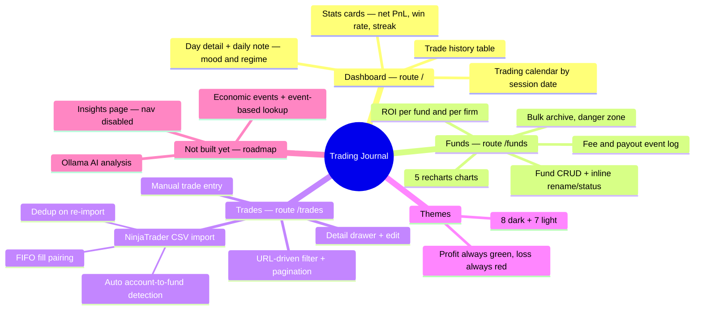

# 01 — Project Overview

## What is this project?

**Trading Journal** is a **self-hosted, single-user** web app for futures prop-firm traders using NinjaTrader. It helps you:

- Track **multiple accounts/funds** across prop firms (Apex, TopStep, Tradeify, Lucid, FundedNext, MFFU…)
- Log **fees** (eval fee, reset fee, activation fee…), **payouts**, and compute **ROI** per fund and per firm
- Record **per-trade P&L** via manual entry or **NinjaTrader CSV import**
- Review performance through the dashboard: daily calendar, stats, charts

## Feature map



## Tech stack

| Layer | Technology | Notes |
|---|---|---|
| Framework | Next.js 16 (App Router) + React 19 | ⚠️ Has breaking changes vs older versions — see "Next.js 16" at the bottom |
| Language | TypeScript (strict) | Alias `@/*` → `src/*` |
| Styling | Tailwind CSS v4 | Theme tokens are CSS variables in `globals.css`; there is no config file |
| UI primitives | shadcn ported to **@base-ui/react** | In `src/components/ui/` — **not Radix** |
| DB | SQLite via `better-sqlite3` | File `data/trading-journal.db`, WAL mode, sync API |
| ORM | Drizzle ORM + drizzle-kit | Schema-first; generated migrations live in `drizzle/` |
| Charts | Recharts | Only used on `/funds` |
| Forms | react-hook-form + Zod | Zod validation in the **server action** is the source of truth |
| CSV | papaparse + date-fns | Parses NinjaTrader "Account Performance" exports |
| Icons | lucide-react | |
| Test | Vitest | Pure logic in `src/lib/`, node environment |

## Key architecture decisions

| Decision | Why |
|---|---|
| SQLite + Drizzle instead of Postgres/Supabase | Local-first, portable file, zero setup. Drizzle makes a later Postgres migration easy if multi-device is ever needed |
| No auth, no multi-tenant | Single-user local app — out of MVP scope |
| No API routes; use Server Actions | SSR + server actions are built in, less boilerplate than a REST layer |
| shadcn (code copied into the repo) | Fully editable, no vendor lock-in |
| Dark mode default, does not follow system | Deliberate — keeps the experience consistent |
| AGPL-3.0 license | Strong copyleft including the network/SaaS clause — anyone distributing the software **or hosting it as a service** must release their source. See the `LICENSE` file |

## Commands

```bash
npm run dev          # dev server → http://localhost:3000
npm run build        # production build
npm run lint         # ESLint
npm run test         # run Vitest once
npm run test:watch   # Vitest watch mode

npm run db:generate  # generate migration SQL from src/db/schema.ts (after editing schema)
npm run db:migrate   # apply migrations to the DB
npm run db:push      # push schema directly, no migration file (dev only)
npm run db:studio    # open Drizzle Studio to inspect the DB
npm run db:seed      # seed sample data
```

> ⚠️ **Note:** the real DB file is `data/trading-journal.db` (see `src/db/index.ts`). The root README mentions `data/journal.db` — that is **wrong**. It can be overridden with the `DATABASE_URL` env var.

## Next.js 16 — read before coding

This repo uses Next.js 16 with the App Router; some APIs/conventions **differ** from older Next.js versions you may know:

- `searchParams` is a **Promise** — you must `await searchParams` in page components.
- When in doubt about an API, read the bundled docs in `node_modules/next/dist/docs/` (see the warning in `AGENTS.md` at the repo root).
- Do not create a `pages/` directory — every route is a React Server Component in `src/app/`.

---

[← Index](README.md) · [Next: Architecture →](02-architecture.md)
