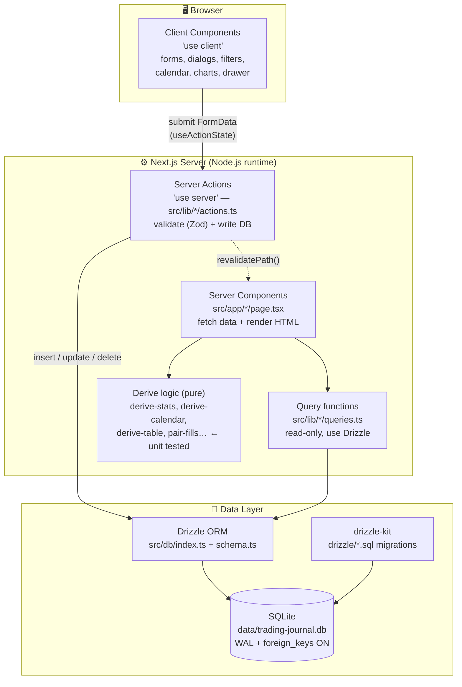
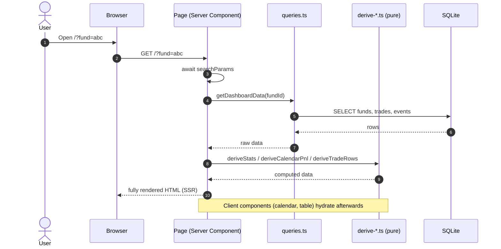
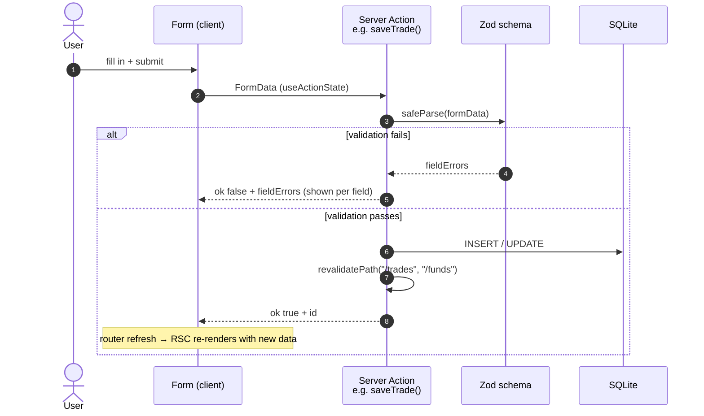
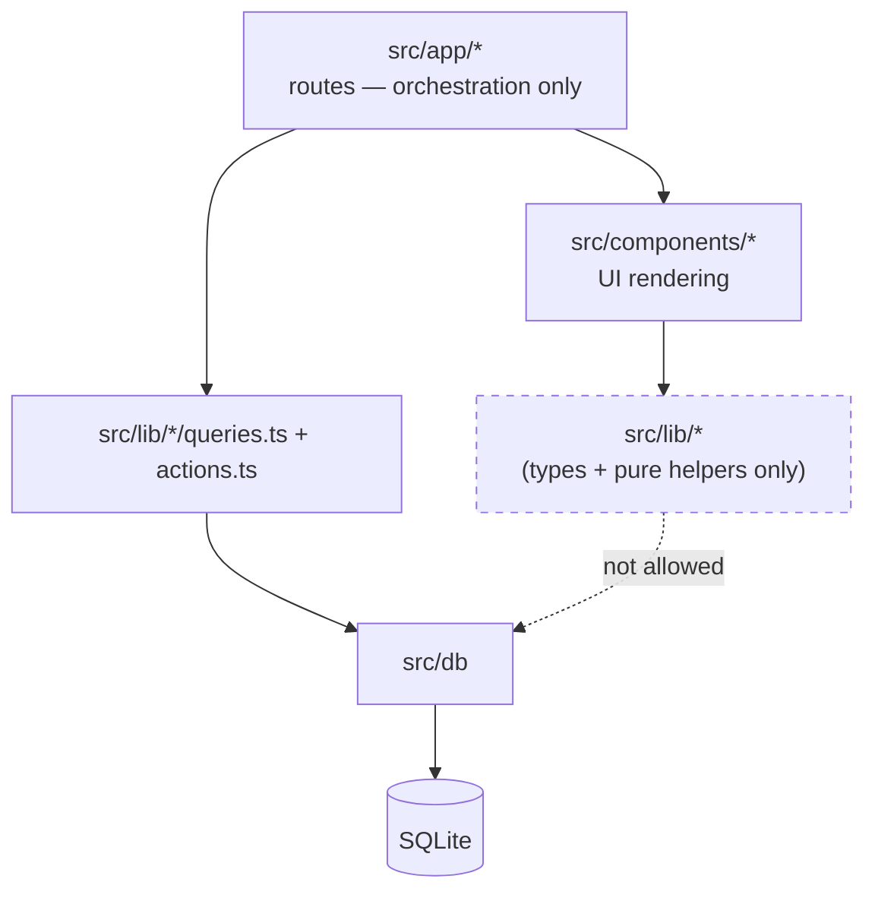

# 02 — Overall Architecture

## Core principles

1. **No intermediate API layer.** No REST, no tRPC, no client-side `fetch` to `/api/...`. Server Components read the DB directly while rendering; Server Actions write to the DB directly on form submit.
2. **Business logic lives in pure functions** under `src/lib/` — no React/DB dependencies → easy to unit test. Components only render.
3. **The URL is the state.** Filters, pagination, which drawer is open… all live in search params → SSR-friendly, shareable, back/forward works.

## Big picture



## READ flow — rendering a page



## WRITE flow — submitting a form



**Form state pattern** — every form-backed server action returns a consistent shape:

```ts
type FormState = { ok: boolean; error?: string; fieldErrors?: Record<string, string[]> };
```

## Current Server Actions

| File | Actions |
|---|---|
| `src/lib/trades/actions.ts` | `saveTrade`, `deleteTrade`, `bulkImport` (CSV) |
| `src/lib/funds/actions.ts` | `saveFund`, `renameFund`, `changeFundStatus`, `archiveFund`, `archiveFunds`, `deleteFund`, `createFundEvent`, `deleteFundEvent` |
| `src/lib/dashboard/day-detail.ts` | `getDayDetail` (read), `upsertDailyNote` (write) |

## Dependency rules (important when adding new code)



- `src/db/schema.ts` is the **single source of truth** for the data model — all shared types (`Fund`, `Trade`…) are exported from here via `$inferSelect`.
- Pure functions in `lib/` **never import `db`** (only `queries.ts` / `actions.ts` do) → testable without a database.
- Components never query the DB directly — they always receive data via props from a parent server component.

## Why no API routes?

- Single-user local app with no external consumers → a REST layer would be pure boilerplate.
- Server Actions + `revalidatePath` give you fresh data after writes for free, no manual client cache invalidation.
- If a mobile app / public API is ever needed, add route handlers then — the logic is already isolated in `lib/`, so you would only wrap it.

---

[← 01 Overview](01-overview.md) · [Index](README.md) · [Next: Database →](03-database.md)
