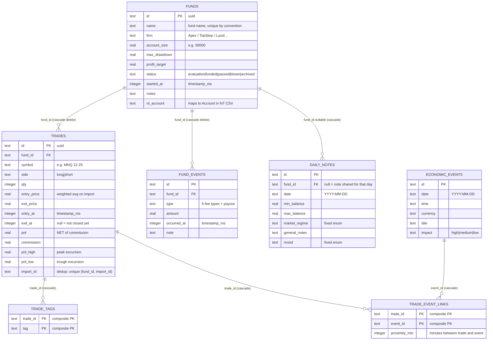
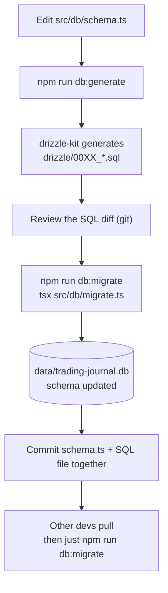

# 03 — Database

## Overview

- **SQLite** file at `data/trading-journal.db` (overridable via the `DATABASE_URL` env var). The `data/` directory is **gitignored** — back it up manually if you care about the data.
- Connection: `src/db/index.ts` — `better-sqlite3` sync API, enables `journal_mode = WAL` + `foreign_keys = ON`.
- The schema is defined in **`src/db/schema.ts`** (Drizzle, SQLite dialect). Types used across the app (`Fund`, `Trade`, `FundEvent`…) are `$inferSelect` results from here.
- Generated migration files live in `drizzle/*.sql` (currently 4: `0000` → `0003`).

## ERD — 7 tables

## Table-by-table details

### `funds` — a prop firm account

- `status` describes the prop account lifecycle: `evaluation` → `funded` (PA) → `passed` / `blown` → `archived`.
- **`archived` has special semantics**: archived funds still **count toward fees/payouts** (real money spent/received) but are **excluded from trade P&L** (treated as sim). See [04-pages.md](04-pages.md).
- `nt_account` is the bridge for CSV imports: the server matches the NinjaTrader `Account` column against this field.

### `trades` — one position, open or closed

- `pnl` is **net of commission**. An open trade has `exitAt IS NULL` and is excluded from all statistics.
- `importId` = the **smallest** fill ID among the fills paired into that trade; used for dedup on re-import (partial unique index — only applies when `import_id IS NOT NULL`, so manual trades are unconstrained).
- Indexes: `(fund_id, entry_at)`, `(entry_at)`, unique `(fund_id, import_id)`.

### `fund_events` — fee & payout cash flow

| `type` | Meaning | Side |
|---|---|---|
| `eval_fee` | Buying an evaluation account | out |
| `pa_fee` / `activation_fee` / `combined_fee` | Fees to get funded | out |
| `reset_fee` | Resetting a blown account | out |
| `other_fee` | Anything else | out |
| `payout` | Withdrawn money | in |

`amount` is always positive; in/out is determined by `type`. This list is also the source of `FUND_EVENT_TYPES` in `src/lib/funds/types.ts`.

### `daily_notes` — daily journal

- `fundId = NULL` means the note is **shared** for that date (how the day-detail feature currently uses it); unique index on `(date, fund_id)`.
- `mood` + `market_regime` are **fixed enums** defined in `src/lib/daily-notes/enums.ts`.

### `economic_events` + `trade_event_links` — foundation of the killer feature

Not used by the UI yet. Roadmap goal: *"when a similar FOMC/NFP event happens again → show every trade around such events in the past, win/loss, and why"*. `proximity_min` stores the minute-distance between a trade and an event to filter for "near event".

## Migration workflow

- **`db:push`** = pushes the schema straight into the DB **without** generating a migration — experimentation only, never for real changes.
- **`db:studio`** = opens Drizzle Studio (a GUI to inspect/edit data) — handy for debugging.
- **Never hand-edit** files in `drizzle/` or modify the DB directly while working on a feature.
- Rule of thumb: a schema change ⇒ its migration ships in the same commit, so any other machine just needs `db:migrate` to work.

---

[← 02 Architecture](02-architecture.md) · [Index](README.md) · [Next: Pages →](04-pages.md)
