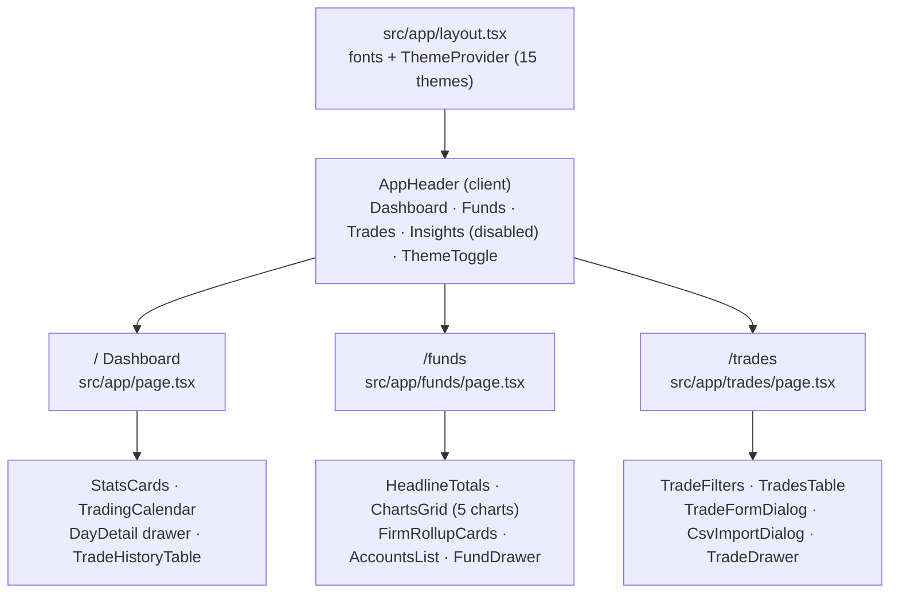
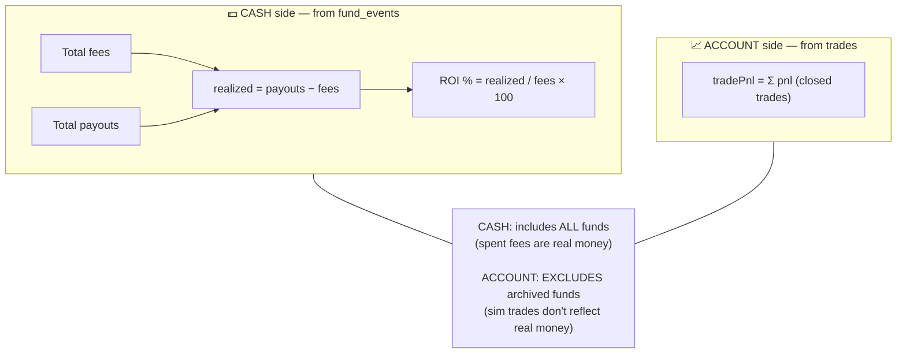
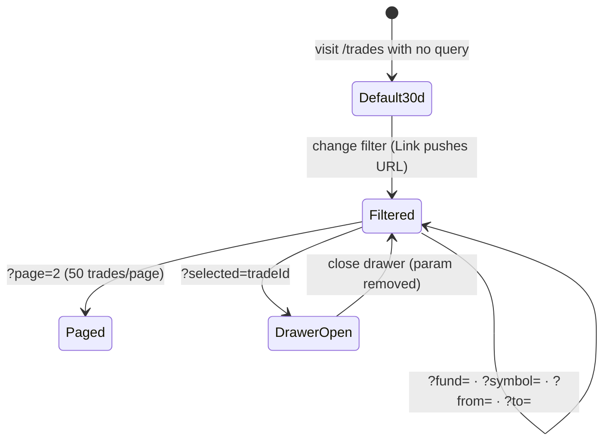

# 04 — Pages & UI

## Route map



Every page is an **async Server Component** receiving `searchParams` (a Promise — must be awaited). The layout uses `max-w-350` with a sticky, backdrop-blurred header.

---

## `/` — Dashboard

```mermaid
flowchart LR
    subgraph "page.tsx (server)"
        A["await searchParams<br/>?fund=..."] --> B["getDashboardData(fundId?)<br/>lib/dashboard/queries.ts"]
        B --> C{"funds.length == 0?"}
        C --|yes| E["Empty state → link to /funds"]
        C --|no| D["deriveStats · deriveCalendarPnl<br/>deriveTradeRows (50 rows)"]
    end
    D --> R1["StatsCards<br/>netPnl · winRate · totalTrades · bestStreak"]
    D --> R2["TradingCalendar<br/>colored by PnL per session date"]
    D --> R3["TradeHistoryTable<br/>50 most recent trades"]
```

Things to know:

- **Data scope:** with `?fund=` set → only that fund (including archived, with a warning banner). Without it → **all active funds** (`status != "archived"`).
- Only **closed trades** count (`exitAt IS NOT NULL`).
- `bestStreak` = the number of consecutive **days** with positive net PnL (grouped by day, not consecutive winning trades).
- Clicking a calendar cell opens the day detail drawer: `getDayDetail(date)` queries trades within the **session range** plus the daily note; `upsertDailyNote(date, data)` saves mood/regime/notes.

## `/funds` — Accounts & ROI

Three-section layout: **overview charts → firm rollup cards → full accounts list**.

### The two "sides" of money — the most important concept on this page



- Headline totals, firm rollups, and the cumulative charts all follow this rule (`deriveTotals`, `deriveByFirm` in `src/lib/funds/derive.ts`).
- **5 charts** (recharts, client components): spend-vs-earn per firm (bar) · status donut · cumulative P&L (line — one cash-event version and one trade version) · ROI per firm (horizontal bar) · payout timeline (scatter).
- Fund cards support: **inline rename** (click the name), **inline status change** (dropdown), bulk archive (checkboxes), and a danger zone (delete fund — cascades to trades/events).

## `/trades` — Trades list

### URL-driven filtering — all state lives in search params



- With no filters → defaults to the **last 30 days**.
- `page.tsx` calls `getTradesPageData(filter)` (in `src/lib/trades/queries.ts`) — one query joining `trades + funds`, one count query, one query fetching `pnl` for the **entire** filtered result (unpaginated) so `netPnl / wins / losses / winPct` are exact, plus two queries for filter options.
- Page size = `TRADES_PAGE_SIZE` = **50**.
- The detail/edit drawer opens with `?selected=`; its data comes from `getTradeById`.

### Adding / editing a trade

`TradeFormDialog` → server action `saveTrade` (Zod validates: symbol 1–50 chars, qty a positive integer, commission ≥ 0, screenshotUrl must be a valid URL…). `pnl` can be entered manually or left empty; CSV imports compute it via pairing (see [05-flows.md](05-flows.md)).

---

## Theme system (applies to every page)

- 15 themes declared in `src/lib/themes.ts` (8 dark + 7 light), applied via `next-themes` (`attribute="class"`, `enableSystem=false`, default `dark`).
- Tokens are CSS variables (OKLCH) in `src/app/globals.css` — Tailwind v4 has no config file.
- **Mandatory invariant:** profit is **always green** (hue 150), loss is **always red** — every theme must keep this (`text-profit`, `text-loss`).
- Fonts: Geist Sans (body) · Geist Mono (uppercase labels) · Instrument Serif (headings + numbers).

---

[← 03 Database](03-database.md) · [Index](README.md) · [Next: Business flows →](05-flows.md)
