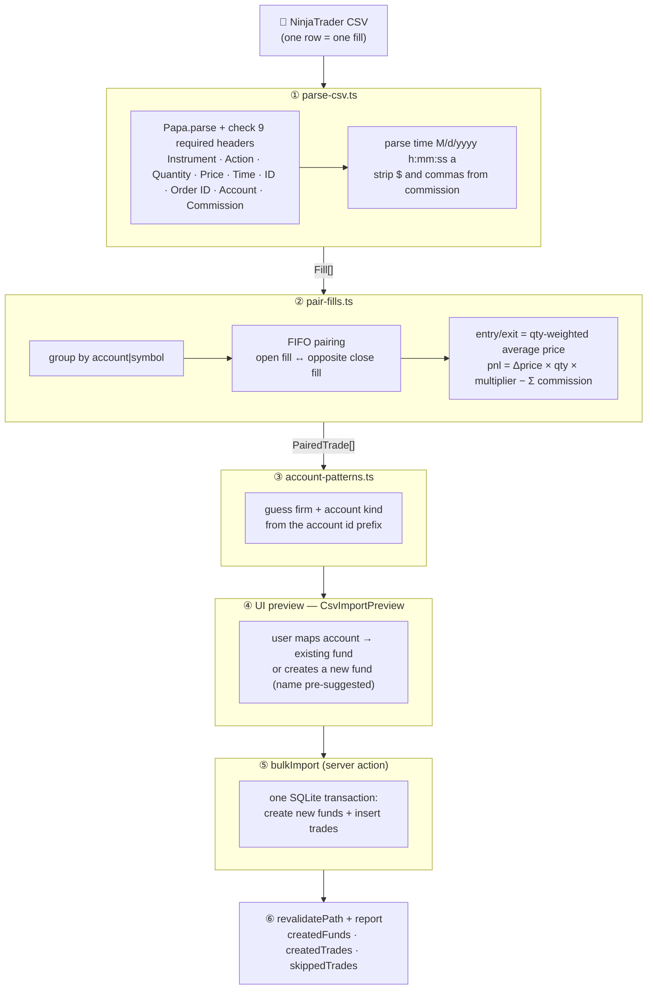
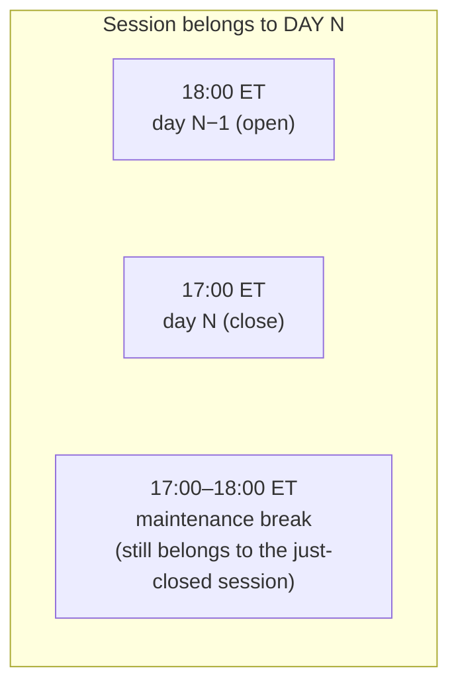
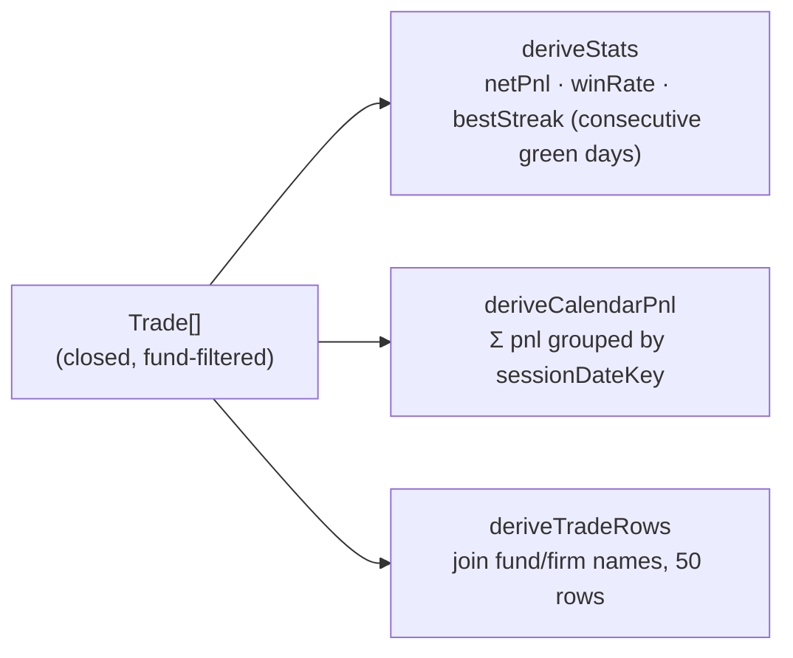

# 05 — Key Business Flows

## 1. NinjaTrader CSV import (the most complex flow)

The source file is a NinjaTrader **"Account Performance" export**: each row is **one fill** (one execution), not a complete trade. The app must pair fills into trades itself.

### FIFO pairing rules (pair-fills.ts)

- A **Buy** fill opens a long, a **Sell** fill closes it (and vice versa for short) within the same `account|symbol` group.
- Multiple same-direction fills before a close are merged into one trade: `qty` = total, entry/exit = **qty-weighted average price**.
- `importId` = the **smallest** fill ID of the trade → stable, used for dedup.
- A trade whose closing fills never arrive is an open position and is not inserted.

### Symbol multipliers (symbol-multipliers.ts)

Futures P&L = price difference × qty × the contract's **multiplier**:

| Root | Mult | Root | Mult |
|---|---|---|---|
| MNQ | 2 | NQ | 20 |
| MES | 5 | ES | 50 |
| M2K | 5 | RTY | 50 |
| MYM | 0.5 | YM | 5 |
| MGC | 10 | GC | 100 |
| MCL | 100 | CL | 1000 |

NinjaTrader symbols look like `"MNQ 12-25"` (root + contract month) — the code strips everything after the first space. Unknown symbols get multiplier 1.

> Example: long 2 MNQ from 21000 → 21050: `(21050−21000) × 2 × 2 = $200` minus commission.

### Account detection (account-patterns.ts)

| Account id | Result |
|---|---|
| `Sim…` | firm "Sim", kind sim → new fund gets status `archived` |
| `LFE…` / `LFF…` | Lucid eval / funded |
| `TDFYSL…` | Tradeify eval |
| `FNFT…` | FundedNext eval |
| (no match) | fallback: connection name (with `Bolt/Pro/Live/Sim` stripped) |

The account kind decides the new fund's status: `funded → funded`, `eval → evaluation`, `sim → archived`, unknown → `evaluation`. Imported funds start with `accountSize = 0` — fix manually afterwards.

### Dedup on re-import

- Unique index `(fund_id, import_id)` + `INSERT … ON CONFLICT DO NOTHING`.
- The server action checks `changes` — conflicting rows (already present) become `skippedTrades`. **Importing the same file twice never duplicates data.**
- The whole import runs in **one transaction** — a mid-way failure (e.g. duplicate fund name) rolls everything back cleanly.

## 2. Session date — the futures "trading day"

The calendar buckets by **CME futures session**, not the calendar day:

- `sessionDateKey(ts)`: at ET hour **≥ 18:00** → belongs to the **next day's** session. (DST-safe via `Intl.DateTimeFormat` + a UTC noon anchor — do not replace this with fixed hour arithmetic!)
- `sessionDateRange(date)` = `[N−1 18:00 ET, N 17:00 ET)` — used by `getDayDetail`.
- **Saturday is a gap** (market closed from Friday evening to Sunday evening); **Sunday evening already belongs to Monday's session**, so it is not a gap.

## 3. Dashboard derivation pipeline

All three are pure functions in `src/lib/dashboard/` — each has a matching `.test.ts` file.

## 4. Day detail + daily note

1. The user clicks a calendar cell (client) → calls the server action `getDayDetail(date, fundId?)`.
2. It queries trades within `sessionDateRange(date)` plus the existing note (`daily_notes` where `fund_id IS NULL`).
3. The user edits mood/regime/notes → `upsertDailyNote(date, data)` — updates if present, inserts otherwise (Zod validates the enums) → `revalidatePath("/")`.

---

[← 04 Pages](04-pages.md) · [Index](README.md) · [Next: Conventions →](06-conventions.md)
