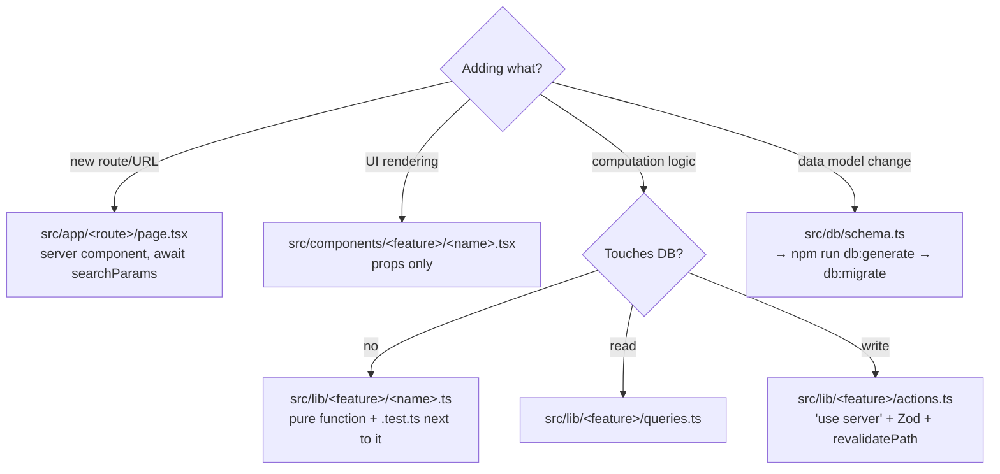
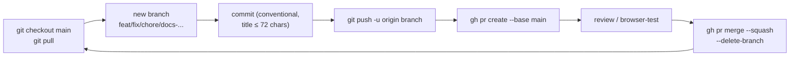

# 06 — Conventions & Working Process

## Where should new code go?



## Server vs Client components

| | Server Component (default) | Client Component (`"use client"`) |
|---|---|---|
| Use for | page.tsx, layouts, data fetching | forms, dialogs, drawers, calendar, charts, filters |
| Allowed to | `await` the DB via queries, async | `useState`, `useActionState`, event handlers |
| Gets data | queries it itself | **via props** from a parent server component |

## Server Action pattern (standardized in this repo)

```ts
// 1. "use server" at the top of the file
// 2. Zod schema + FormData → raw object (emptyToNull for empty inputs)
// 3. safeParse → on failure return { ok: false, fieldErrors }
// 4. Drizzle insert/update
// 5. revalidatePath every affected page
//    (e.g. saveTrade revalidates BOTH /trades AND /funds)
```

Return the form state (or throw for simple actions like `deleteTrade(id)`).

## Testing

- **Vitest**, node environment, includes `src/**/*.test.ts(x)`, alias `@` → `src`.
- Test files sit **next to the implementation** (`derive-stats.ts` + `derive-stats.test.ts`).
- Coverage focuses on **pure logic**: CSV parsing, FIFO pairing, derivations, session dates (DST!), account patterns. Components and the DB are not tested.
- Run: `npm run test` (run it before pushing).

## Theming — invariants

- Adding a theme = a new entry in `src/lib/themes.ts` + a CSS variables block in `globals.css`.
- **Mandatory**: profit green (hue 150), loss red — in every theme. Use the `text-profit` / `text-loss` classes; never hard-code colors.
- Dark default, `enableSystem = false` — intentional.

## Formatting & style

- Currency: `formatCurrency` (`src/lib/format.ts`) — always go through this helper, never hard-code `$`.
- Dates: `date-fns`; ET session/day helpers live in `src/lib/dashboard/session-date.ts` (don't roll your own timezone math).
- Tailwind: use design tokens (`text-muted-foreground`, `bg-primary/10`…), avoid raw colors.

## Git workflow (mandatory since Phase 1)



- **Never commit directly to `main`** — not even for solo work.
- Keep PR bodies short: Summary bullets + Test plan checklist.
- Branch prefixes: `feat/` · `fix/` · `chore/` · `docs/`.

## Pre-PR checklist

1. `npm run lint` is clean.
2. `npm run test` passes.
3. `npm run build` succeeds (better-sqlite3 needs a native build — can be slow the first time).
4. New logic is a pure function with unit tests.
5. Touched the schema ⇒ migration generated + applied locally.
6. Browser-tested the feature's main flow.

---

[← 05 Business flows](05-flows.md) · [Index](README.md)
