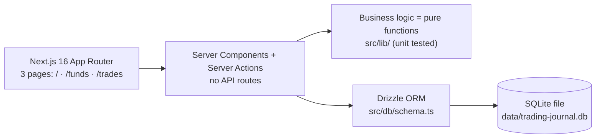

# Trading Journal — Architecture Documentation

> This doc set is written for developers joining the project. Read the files in numbered order. All diagrams use [Mermaid](https://mermaid.js.org/) — GitHub and VS Code (with the "Markdown Preview Mermaid Support" extension) render them natively.

## Reading order

| # | File | Contents | When to read |
|---|------|----------|--------------|
| 1 | [01-overview.md](01-overview.md) | What the project is, features, tech stack, commands | Day one |
| 2 | [02-architecture.md](02-architecture.md) | Overall architecture, read/write flows, Server Components vs Server Actions | Day one |
| 3 | [03-database.md](03-database.md) | 7-table ERD, table-by-table details, migration workflow | Before touching data |
| 4 | [04-pages.md](04-pages.md) | The 3 pages in detail (Dashboard / Funds / Trades), URL-driven state | Before changing UI |
| 5 | [05-flows.md](05-flows.md) | Business flows: CSV import, FIFO pairing, session dates, P&L derivation | Before changing business logic |
| 6 | [06-conventions.md](06-conventions.md) | Code conventions, testing, theming, git workflow | Before writing code / committing |

## 30-second summary

- **Single-user, local-first** — no auth, no multi-tenant.
- All page state lives in **URL search params** — there is no client state store.
- Schema changes must go through the **migration workflow** (see [03-database.md](03-database.md)).
- Working rule: **branch + PR — never commit directly to `main`** (see [06-conventions.md](06-conventions.md)).

## Notes

- This documentation describes the **actual** code in `src/`. If docs and code disagree, **code is the source of truth** — and please fix the docs.
